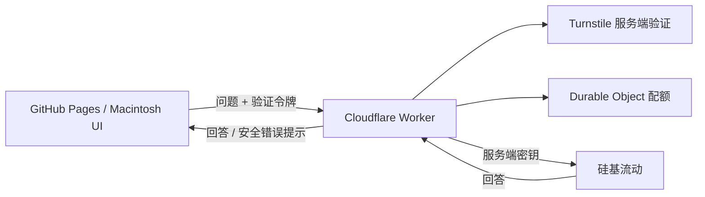

# Personal Website

一个基于 React + TypeScript + Tailwind CSS 构建的个人网站项目。

## Macintosh 主页

主页仅展示一台居中的 Macintosh，所有内容与导航都在屏幕内。外观以初代 Macintosh 为灵感：带贴纸白边与材质阴影的米色机身，屏幕内运行可交互的黑白桌面。机身使用 CSS 绘制，像素图标和光标使用 SVG，不依赖 WebGL 或外部图片服务。

- `Starry HD` 是个人主页第一页：学历、Agentic Memory 工作、Long-horizon 研究兴趣和字节 AutoBench 实习经历；`About me` 展示性格与个人兴趣。点击桌面图标切换页面，点击窗口左上角关闭。
- 拖动窗口标题栏可移动窗口，范围限制在屏幕内；触屏端保留点击和滚动。
- 首页顶部通过 `Enter desktop` 明确提示进入全屏桌面，按钮在打开时黑白反色闪烁三次；遵守系统的减少动态效果设置。状态栏也保留入口；点击窗口右上角或 `View > Expand screen` 也可进入，按 Escape 返回。全屏默认窗口占据桌面的主要区域。
- `About me` 保留原版七个性格图标的两秒轮播，使用黑白像素图标和阶梯切换；可暂停、手动切换，并遵守系统的减少动态效果设置。
- `Starry HD` 与 `About me` 提供 `Download CV` 按钮，只下载 PDF，不在页面内嵌预览；两页共用彩色像素头像。
- `Special > Restart` 重放开机过程；机身右下角的指示灯可休眠，点击屏幕唤醒。
- `Ask Starry` 通过 Cloudflare Worker 调用硅基流动；密钥仅保存在服务端，限流与配额由服务端执行。
- `Contact` 提供 GitHub 链接、邮件链接和微信号复制。
- 思考、友人仍是待建设页面；字体均随项目本地加载，授权见 `Attributions.md`。

实现按职责分开：`src/components/mac/Macintosh.tsx` 管理机身、开机和屏幕放大；`Desktop.tsx` 管理菜单与窗口；`WindowContent.tsx` 放置页面内容和 Bot 表单；`Personality.tsx` 管理性格图标轮播；`PixelIcon.tsx` 提供像素图标；`AppleLogo.tsx` 复用 Apple 标志轮廓；`src/styles/macintosh-hardware.css` 管理机身与居中舞台；`src/styles/macintosh.css` 管理屏幕内的桌面与响应式布局。

## 技术栈

- **React 18** - UI 框架
- **TypeScript** - 类型安全
- **Vite** - 构建工具
- **Tailwind CSS** - 样式框架
- **Framer Motion** - 动画库
- **shadcn/ui** - UI 组件库
- **Lucide React** - 图标库

## 项目结构

```
Personal_web/
├── src/
│   ├── assets/          # 静态资源
│   ├── components/      # React 组件
│   │   ├── figma/       # Figma 相关组件
│   │   └── ui/          # UI 组件库
│   ├── styles/          # 样式文件
│   ├── App.tsx         # 主应用组件
│   └── main.tsx        # 应用入口
├── .github/
│   └── workflows/      # GitHub Actions 工作流
├── public/             # 公共资源
├── index.html          # HTML 入口
├── vite.config.ts      # Vite 配置
├── tsconfig.json       # TypeScript 配置
├── tailwind.config.js  # Tailwind 配置
└── package.json        # 项目配置
```

## 开发

### 安装依赖

```bash
npm install
```

### 本地开发

```bash
npm run dev
```

访问 http://localhost:5173

### 构建生产版本

```bash
npm run build
```

### 预览构建结果

```bash
npm run preview
```

## 部署到 GitHub Pages

### 自动部署

项目已配置 GitHub Actions 工作流，当你推送代码到 `main` 分支时，会自动构建并部署到 GitHub Pages。

### 手动部署

1. 确保 GitHub Pages 已启用（Settings > Pages）
2. 构建项目：
   ```bash
   npm run build:gh-pages
   ```
3. 将 `dist/` 目录的内容推送到 `gh-pages` 分支

### 访问网站

部署成功后，网站将可通过以下地址访问：
- https://mustbeasaltyfish.github.io/

## 图片资源

头像位于 `src/assets/images/avatar.jpg`，由 `Home.tsx` 和 `WindowContent.tsx` 的个人介绍共用，保留原图与像素效果。CV 原始 PDF 位于 `src/assets/documents/yukai-wu-cv.pdf`，下载入口统一由 `src/components/mac/CvDownload.tsx` 提供，构建时通过 Vite 生成资源地址。更新 CV 时替换该 PDF 即可。机身、键盘和鼠标由 CSS 绘制；桌面图标为项目内 SVG；像素光标位于 `src/assets/images/mac-arrow.svg` 和 `mac-text.svg`。

## Bot 功能配置

Ask Starry 使用硅基流动的 `deepseek-ai/DeepSeek-V3.2`，人格提示位于 `backend/src/persona.ts`。前端只发送问题与 Turnstile 验证令牌，Worker 固定模型、提示词、300 个输出 token 和 200 字回答上限。



### 本地联调

```bash
npm ci
npm ci --prefix backend
cp backend/.dev.vars.example backend/.dev.vars.local
# 编辑 backend/.dev.vars.local，填入 SILICONFLOW_API_KEY
npm run dev --prefix backend
# 另一个终端：
npm run dev
```

Vite 的开发和预览服务器将 `/api` 转发到 `127.0.0.1:8787`。`.dev.vars.local` 已加入忽略列表；不要把密钥放入任何 `VITE_` 变量。仅 `--env local` 且请求地址为 localhost 时跳过 Turnstile；生产接口缺少密钥、验证 Secret 或配额配置时拒绝服务。

### Cloudflare 部署

当前 Worker 地址：`https://starry-bot-api.2965426422.workers.dev/api/chat`。GitHub Actions 的两个公开变量已配置；供应商密钥和 Turnstile Secret 仅保存在 Worker。

1. 在 Cloudflare Turnstile 创建 Managed widget，允许 `mustbeasaltyfish.github.io`。记录公开的 Site key；Secret key 仅交给 Worker。
2. 在 `backend` 目录登录并部署 Worker：

   ```bash
   npx wrangler login
   npm run deploy
   npx wrangler secret put SILICONFLOW_API_KEY --env ""
   npx wrangler secret put TURNSTILE_SECRET_KEY --env ""
   ```

   `secret put` 会交互式读取密钥，不要将密钥写进命令行或 `wrangler.jsonc`。Worker 首次部署后，在配置齐全之前处于拒绝服务状态。
3. 在 GitHub 仓库 **Settings → Secrets and variables → Actions → Variables** 配置公开变量：

   | 变量 | 值 |
   | --- | --- |
   | `VITE_BOT_API_URL` | `https://<Worker 地址>/api/chat` |
   | `VITE_TURNSTILE_SITE_KEY` | Turnstile Site key |

4. 按当前分支的审核/合并流程发布主页。GitHub Actions 不再读取硅基流动密钥。若旧版本曾上线并将密钥打包到前端，需要先在硅基流动撤销/轮换旧密钥；新的服务端架构不能消除历史泄露。

### 配额与安全边界

`backend/wrangler.jsonc` 默认只允许本站 Origin，Turnstile 验证每次请求的 token、hostname 和 `starry-chat` action。CORS 约束浏览器访问，不能替代验证和限流。

全局单个 SQLite Durable Object 通过存储事务预留额度，默认每个 IP 每分钟 3 次、每天 20 次、全站每天 200 次；UTC 零点重置。失败的模型请求也消耗额度，以限制失败重试的开销。只存当天计数和 IP 的 SHA-256 摘要，不保存问题或回答。共享网络的访客会共享 IP 配额。这是请求数上限，不能替代供应商账单预算；不保证公开服务完全无法被滥用。

Worker 不向浏览器转发供应商错误、授权头或密钥；服务端请求有超时限制。`GET /api/health` 返回配置是否齐全，不能代替真实问答检查。

### 验证

```bash
npm run build
npm run check --prefix backend
npm test --prefix backend
```

测试覆盖非法来源与输入、生产配置缺失、验证失败、服务端固定模型、上游错误脱敏、限流和日额度重置。生产部署后，还需用真实 Turnstile 在主页完成问答，再确认失败令牌被拒绝。

## 开发注意事项

- 使用 TypeScript 确保类型安全
- 遵循 Tailwind CSS 最佳实践
- 组件使用 shadcn/ui 设计系统
- 动画使用 Framer Motion (motion/react)

## 许可证

MIT License
